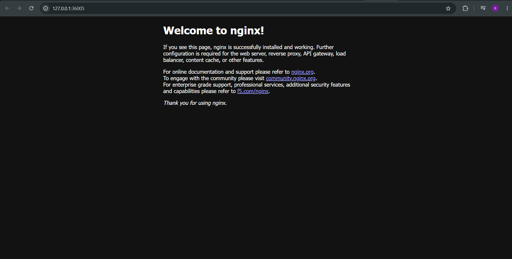
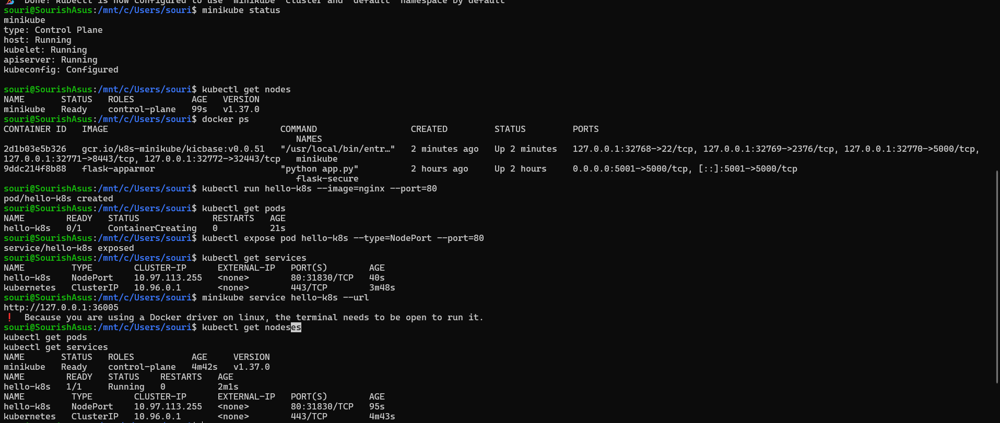

# Exercise 1 — Kubernetes Getting Started

## Final Result

The Nginx application was successfully deployed as a Kubernetes Pod using Minikube and accessed through a Kubernetes Service.

### Final Nginx Page

---

## Commands Executed

The following commands were executed in the Ubuntu terminal (WSL) to create the Minikube cluster, deploy the Nginx Pod, verify its status, expose it as a service, and access the application.

### Commands Screenshot

---

## Technologies Used

- **Kubernetes** — Container orchestration
- **Minikube** — Runs a local Kubernetes cluster
- **Docker** — Container runtime
- **kubectl** — Manages Kubernetes resources
- **Nginx** — Web server application

## Steps Performed

1. Installed Minikube and kubectl.
2. Started a local Kubernetes cluster using Docker.
3. Deployed an Nginx Pod.
4. Verified the Pod status.
5. Exposed the Pod using a NodePort Service.
6. Accessed the Nginx welcome page through the browser.

## Conclusion

Successfully completed the Kubernetes Getting Started exercise by deploying an Nginx application on Minikube and accessing it through a Kubernetes Service.
