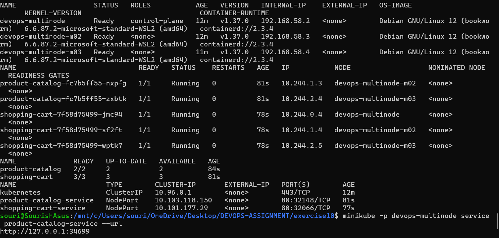
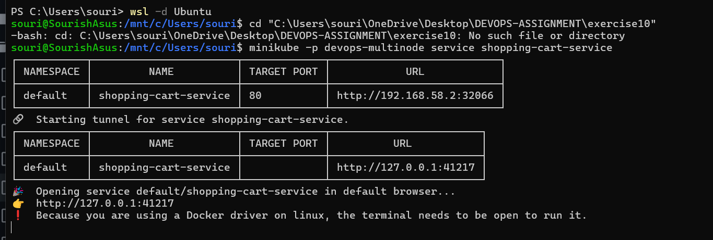
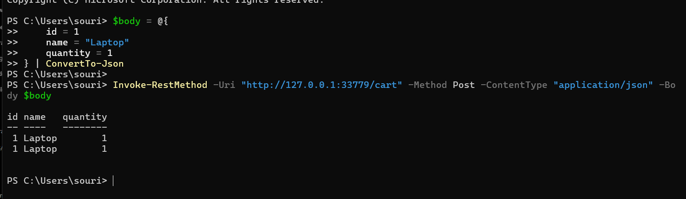
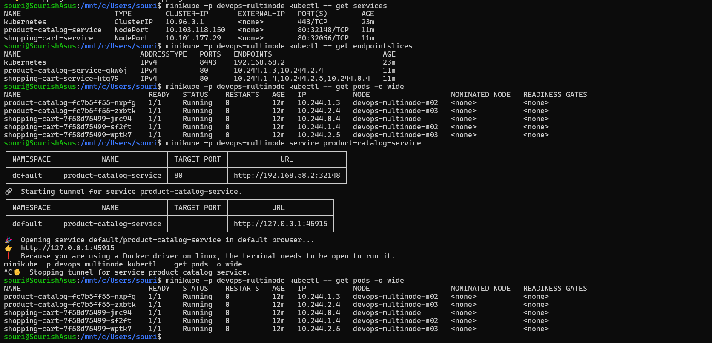

# Exercise 10: Multi-Node Kubernetes Cluster with Multiple Applications and Replicasets

## 1. Cluster and pod distribution

The cluster has three nodes in `Ready` state. All five application pods should be `Running`, with `1/1` containers ready and zero restarts.

| Node | Product Catalog pods | Shopping Cart pods |
|---|---:|---:|
| `devops-multinode` | 0 | 1 |
| `devops-multinode-m02` | 1 | 1 |
| `devops-multinode-m03` | 1 | 1 |



## 2. Product Catalog endpoint

Test the Product Catalog endpoint through the Minikube service tunnel. Keep the terminal running the tunnel open, and use the actual local port shown on your machine.

```powershell
curl.exe http://127.0.0.1:<PRODUCT_CATALOG_PORT>/products
```

The response should contain Laptop, Phone, and Headphones.



## 3. Shopping Cart endpoint

The Shopping Cart GET endpoint initially returns an empty list. Test adding a Laptop with quantity `1` using PowerShell:

```powershell
$body = @{
    id       = 1
    name     = "Laptop"
    quantity = 1
} | ConvertTo-Json -Compress

Invoke-RestMethod `
    -Uri "http://127.0.0.1:<SHOPPING_CART_PORT>/cart" `
    -Method Post `
    -ContentType "application/json" `
    -Body $body
```

Replace `<SHOPPING_CART_PORT>` with the port shown by your active Shopping Cart Minikube tunnel.



**Note:** The cart is stored in application memory. Since the service has multiple replicas, separate requests may reach different pods and show different cart contents.

## 4. Services and Minikube tunnels

The Services were created successfully:

- `product-catalog-service`: NodePort `32641`, target port `80`
- `shopping-cart-service`: NodePort `31352`, target port `80`

Example local tunnel URLs from the test run (the ports can change when tunnels are restarted):

- Product Catalog: `http://127.0.0.1:49883`
- Shopping Cart: `http://127.0.0.1:58908`

Keep each terminal running `minikube service` open while using its local tunnel URL.


