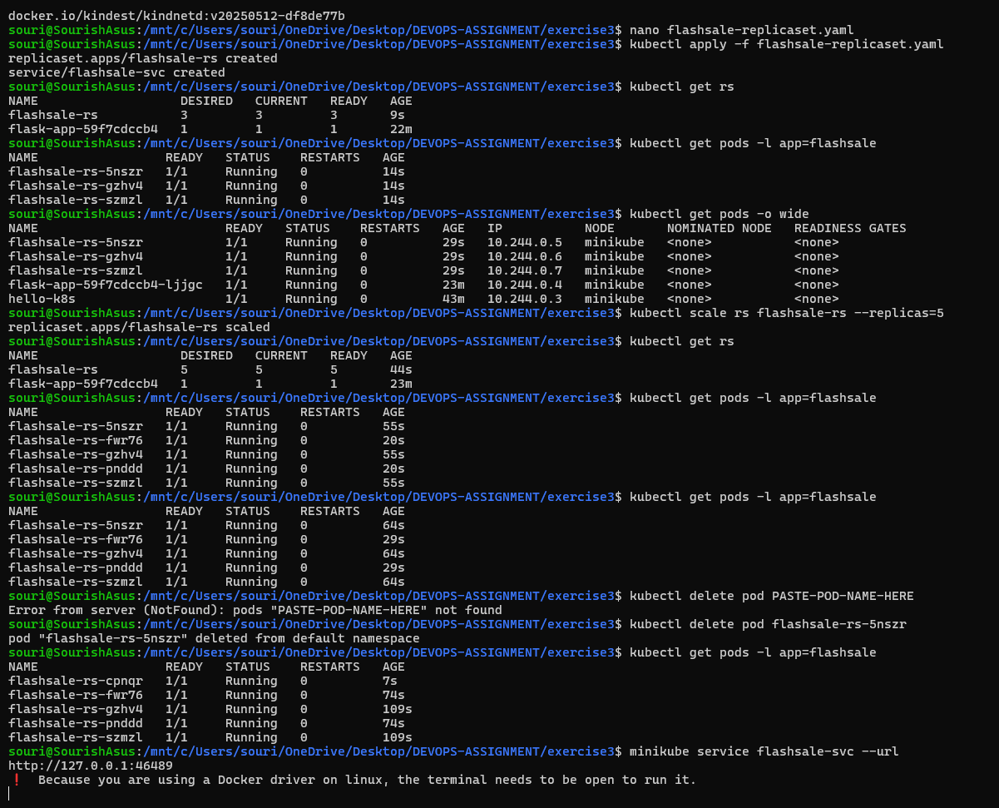
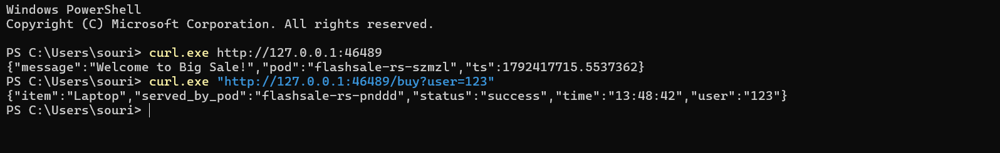

# Exercise 3 — Scaling Flask App on Single Node using ReplicaSets

## Final Result

The Flask Flash Sale application was successfully deployed on a single-node Minikube cluster using a Kubernetes ReplicaSet.

The application was initially deployed with **3 replicas** and was successfully scaled to **5 replicas**. All 5 Pods were running and ready after scaling.

### PowerShell Commands and Kubernetes Output

---

### Flask Application Output

The Flask application was accessed through the Minikube service and returned the following responses.

The homepage returned a welcome message and the Pod that handled the request. The `/buy` endpoint successfully simulated a purchase for user `123` and returned the selected item and serving Pod.

